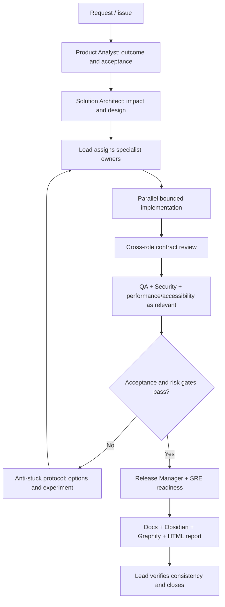

# Delivery workflow

## Change packet
Each task has: ID, objective, acceptance criteria, owner, reviewers, affected components, interfaces, test plan, documentation targets, risk, status.

## Status vocabulary
`proposed → planned → in_progress → blocked → in_review → verified → released`
Use `deferred` or `cancelled` with a reason. Never mark `verified` based on assumptions.

## Handoff format
- **Outcome / status**
- **Changed surfaces**
- **Contracts and decisions**
- **Verification**
- **Documentation updated**
- **Risks / blockers / next owner**

The handoff format above describes the summary of an individual
handoff execution. It does not replace the reusable handoff contract.

Formal handoff contracts are defined in `docs/team/ownership.yml`
according to `docs/team/handoff-contract-schema.md`.

A handoff execution should reference the applicable contract ID
and version when a formal contract exists.

## Handoff acceptance process

An individual handoff execution follows this sequence:

1. Producer submits the required outputs and supporting context.
2. Consumer identifies the applicable contract ID and version.
3. Consumer evaluates each applicable acceptance check.
4. Consumer records an overall decision:
   `accepted`, `partially_accepted`, `rejected`, or `blocked`.
5. When corrections are required, the producer submits a revised
   output referencing the previous submission.
6. Consumer reassesses the affected checks and records the new decision.
7. Handoff closure is recorded only after outstanding required work
   has been resolved.

The detailed rules are documented in:

`docs/team/handoff-acceptance-rules.md`

A submitted file or message alone does not constitute acceptance.

## Escalation and conflict resolution

Resolve disagreements at the lowest appropriate level.

1. Producer and consumer attempt direct resolution using the applicable
   contract, requirements, and evidence.
2. Unresolved specialist-domain issues go to the accountable domain owner.
3. Cross-system technical conflicts go to the Solution Architect.
4. Product, business, or risk decisions requiring external authority
   go to the appropriate authorized stakeholder or risk owner.
5. The Delivery Lead coordinates escalation, tracks blockers, and
   records delivery impact.

Urgent security, privacy, safety, data-integrity, and production-stability
concerns must be escalated immediately rather than waiting for normal
response windows.

An expired response window does not mean acceptance, rejection,
approval, or risk acceptance.

Unresolved work remains blocked when proceeding would violate a required
dependency, safety constraint, or approval gate.

Detailed procedures are documented in:

`docs/team/handoff-escalation-rules.md`