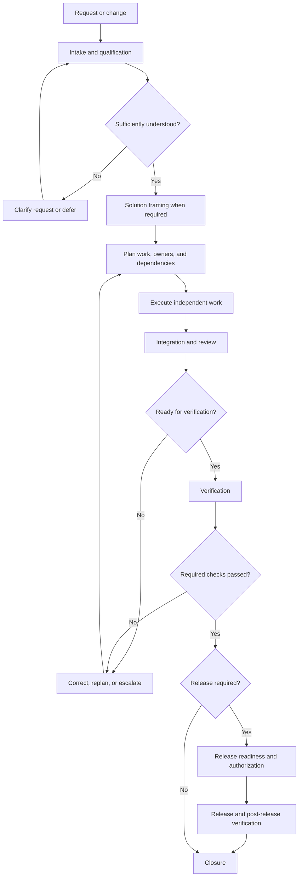

# Delivery workflow

## Workflow lifecycle

The detailed workflow lifecycle, stage definitions, entry and exit
conditions, status transitions, and progression gates are defined in:

`docs/team/workflow-lifecycle.md`

The lifecycle is adaptable to task complexity and risk. It does not
require every task to execute every stage or activate every specialist.

Workflow progression must preserve the established artifact ownership,
responsibility boundaries, producer-consumer relationships, and
handoff acceptance rules.

## Role activation and participation

Role activation is governed by:

`docs/team/role-activation-rules.md`

Roles are activated according to task scope, responsibility boundaries, dependencies, and risk. The 17-role team is not a mandatory checklist for every task.

Task planning must distinguish required, conditional, optional, and inactive roles while preserving accountable artifact ownership and specialist authority.

Role activation does not automatically create a formal handoff or transfer artifact ownership.

## Dependency-aware execution and parallel work

Execution dependencies and parallel-work rules are governed by:

`docs/team/dependency-execution-rules.md`

Work must be sequenced according to explicit prerequisites. Independent work may proceed in parallel when ownership boundaries, interfaces, and safety conditions permit it.

The execution dependency graph must remain acyclic. Collaboration and feedback relationships may be bidirectional.

A blocked prerequisite must only prevent the work items or progression gates that actually depend on it. Provisional upstream outputs may be consumed only under the documented controls and must be reconciled before required integration and verification gates.

Dependency coordination does not transfer artifact ownership or replace formal handoff acceptance.

## Orchestration and coordination

Cross-role orchestration and coordination responsibilities are governed by:

`docs/team/orchestration-responsibilities.md`

Coordination must occur at the lowest level that can manage the work effectively. Accountable package owners coordinate their own outputs, specialist owners coordinate domain-specific work, and the Delivery Lead coordinates cross-role execution when needed.

Coordination does not transfer artifact ownership, override specialist authority, or constitute approval of required verification and acceptance evidence.

## Change packet
Each task has: ID, objective, acceptance criteria, owner, reviewers, affected components, interfaces, test plan, documentation targets, risk, status.

## Workflow and work-item states

Overall workflow statuses are defined in:

`docs/team/workflow-lifecycle.md`

Individual work-item states and their allowed transitions are defined in:

`docs/team/blockers-replanning-and-state-transitions.md`

Formal handoff decisions use a separate vocabulary defined in:

`docs/team/handoff-acceptance-rules.md`

Do not treat workflow status, work-item state, and handoff decision
as interchangeable.

## Handoff format
- **Outcome / handoff decision**
- **Changed surfaces**
- **Contracts and decisions**
- **Verification**
- **Documentation updated**
- **Risks / blockers / next owner**

The handoff format above describes the summary of an individual
handoff execution. It does not replace the reusable handoff contract.

Formal handoff contracts are defined in `docs/team/ownership.yml`
according to `docs/team/handoff-contract-schema.md`.

A handoff execution should reference the applicable contract ID
and version when a formal contract exists.

## Handoff acceptance process

An individual handoff execution follows this sequence:

1. Producer submits the required outputs and supporting context.
2. Consumer identifies the applicable contract ID and version.
3. Consumer evaluates each applicable acceptance check.
4. Consumer records an overall decision:
   `accepted`, `partially_accepted`, `rejected`, or `blocked`.
5. When corrections are required, the producer submits a revised
   output referencing the previous submission.
6. Consumer reassesses the affected checks and records the new decision.
7. Handoff closure is recorded only after outstanding required work
   has been resolved.

The detailed rules are documented in:

`docs/team/handoff-acceptance-rules.md`

A submitted file or message alone does not constitute acceptance.

## Escalation and conflict resolution

Resolve disagreements at the lowest appropriate level.

1. Producer and consumer attempt direct resolution using the applicable
   contract, requirements, and evidence.
2. Unresolved specialist-domain issues go to the accountable domain owner.
3. Cross-system technical conflicts go to the Solution Architect.
4. Product, business, or risk decisions requiring external authority
   go to the appropriate authorized stakeholder or risk owner.
5. The Delivery Lead coordinates escalation, tracks blockers, and
   records delivery impact.

Urgent security, privacy, safety, data-integrity, and production-stability
concerns must be escalated immediately rather than waiting for normal
response windows.

An expired response window does not mean acceptance, rejection,
approval, or risk acceptance.

Unresolved work remains blocked when proceeding would violate a required
dependency, safety constraint, or approval gate.

Detailed procedures are documented in:

`docs/team/handoff-escalation-rules.md`

## Blockers, replanning, and workflow state transitions

Blocker management, replanning decisions, and work-item state transitions are governed by:

`docs/team/blockers-replanning-and-state-transitions.md`

All work-item state changes must follow the approved transition rules. Blockers must have accountable owners, documented impact, and traceable resolution evidence.

Replanning must preserve artifact ownership, specialist decision authority, dependency integrity, and previously recorded decisions. The Delivery Lead coordinates cross-role replanning but does not independently approve specialist decisions or waive required verification gates.

Workflow stage progression, individual work-item states, and formal handoff decisions must remain separate and independently traceable.

## Execution records and traceability

The canonical execution record architecture is defined in:

`docs/team/execution-record-model.md`

Execution records document actual project and change activity. They
must preserve artifact ownership, workflow status distinctions,
formal handoff governance, and traceable verification evidence.

The identity hierarchy and traceability requirements for projects,
changes, and execution instances are defined in:

`docs/team/execution-identity-and-traceability.md`