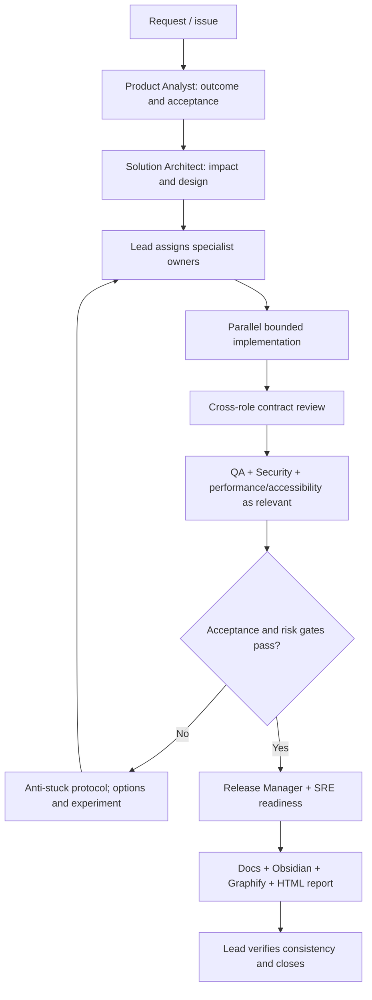

# Delivery workflow

## Change packet
Each task has: ID, objective, acceptance criteria, owner, reviewers, affected components, interfaces, test plan, documentation targets, risk, status.

## Status vocabulary
`proposed → planned → in_progress → blocked → in_review → verified → released`
Use `deferred` or `cancelled` with a reason. Never mark `verified` based on assumptions.

## Handoff format
- **Outcome / status**
- **Changed surfaces**
- **Contracts and decisions**
- **Verification**
- **Documentation updated**
- **Risks / blockers / next owner**

The handoff format above describes the summary of an individual
handoff execution. It does not replace the reusable handoff contract.

Formal handoff contracts are defined in `docs/team/ownership.yml`
according to `docs/team/handoff-contract-schema.md`.

A handoff execution should reference the applicable contract ID
and version when a formal contract exists.